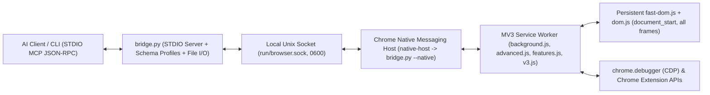

<div align="center">

# Max Browser MCP

**English** | [Русский](README.ru.md)

[](https://github.com/DanielLetto2020/max-browser-mcp/releases)
[](LICENSE)
[](#complete-tool-groups-83-tools)
[](extension/manifest.json)
[](bridge.py)

**Standalone local Chrome MV3 extension + Native Messaging host + STDIO MCP server.**  
Control your live Chrome browser from AI agents and scripts with **83 tools**, **>50% fewer schema tokens**, **single-IPC batch execution**, and **zero cloud dependencies**.

</div>

---

## Why Max Browser MCP?

Unlike headless Playwright or Puppeteer runners that launch clean disposable browsers, **Max Browser MCP** works inside **your real Chrome session**:

- **Live Browser & Real Sessions**: Keeps your existing tabs, logins, cookies, extensions, and proxy/VPN environment.
- **100% Local & Zero Runtime Dependencies**: Pure Python stdlib bridge (`bridge.py`), Chrome Native Messaging, private `0600` Unix socket (`run/browser.sock`), and vanilla MV3 JavaScript — no Node runtime or npm packages required in production.
- **Built for AI Efficiency**: Engineered specifically to cut LLM token usage and round-trip latency without sacrificing reliability.

## Architecture



## Token Savings (50%–80% Less Context Overhead)

| Feature | How It Saves Tokens |
| :--- | :--- |
| **Tool Profiles (`--profile`)** | `core` exposes **24 essential tools** (~60% fewer schema tokens in `tools/list`), `qa` exposes **44 tools**, `full` exposes all **83 tools** — while **all 83 tools remain callable** via `tools/call` in any profile. |
| **Compact Action Responses** | Pass `compact: true` or toggle global `compactResponses` via `browser_config` to trim redundant metadata from action replies. |
| **Single-Turn `afterSnapshot`** | Attach `afterSnapshot: "diff" | "interactive" | "tree"` directly to `click`, `fill`, `fill_form`, `select_option`, `set_checked`, `press_key`, `navigate`, `reload`, `history`, or `batch`. |
| **Focused DOM Reads** | `page_snapshot` supports `viewportOnly`, `skipLandmarks`, `compactLists`, and short `ref` handles (`abc-1`); `get_page_text` supports `grep`/`around` regex filtering; `diagnostics_get` supports `summaryOnly`. |
| **Clean Extraction** | `page_markdown` converts articles/tables/lists to clean Markdown; `extract_structured` extracts typed JSON rows (`@href`, `@src`, `@text`) without raw HTML bloat. |
| **Screenshot Optimization** | `preset: "fast"` (1024px JPEG), `dedupe: true` (skip returning identical frames by hash), `grid: true` (pixel coordinate overlay), and `savePath` (write directly to disk). |

## Speed Architecture

- **Persistent `fast-dom.js`**: Preloaded at `document_start` across all frames so DOM queries/snapshots execute via persistent message channels without repeated `chrome.scripting.executeScript` overhead.
- **Single-IPC Server-Side `batch`**: Execute sequences of steps in one bridge round-trip (`_batch_exec`), supporting `fuseDom`, `optional`, `when`, `repeatUntil`, `parallel`, and `{{$stepN.path}}` result templates.
- **Runtime Tuning (`browser_config`)**: Switch `speedMode` between `visual`, `fast`, and `instant`, configure global `compactResponses`, `defaultScreenshotPreset` (`fast`/`normal`/`hd`), and `idleDebuggerLeaseMs`.
- **Smart Debugger Reuse**: Keeps `chrome.debugger` attached for configurable idle leases instead of re-attaching per action.
- **Bulk Forms & In-Page Fetch**: `fill_form` populates multiple fields in one call; `page_fetch` runs authenticated `fetch()` inside the page context.

## Complete Tool Groups (83 Tools)

<details>
<summary>Expand full catalog of all 83 MCP tools across 8 categories</summary>

1. **Tabs, Windows & History (15)**  
   `tabs_list`, `tabs_create`, `tabs_move`, `tabs_reorder`, `tabs_activate`, `tabs_update`, `tabs_duplicate`, `tabs_close`, `windows_list`, `wait_tab`, `groups_list`, `tabs_group`, `group_update`, `tabs_ungroup`, `bookmarks_and_history`
2. **Navigation, Viewport & Control (12)**  
   `navigate`, `reload`, `history`, `wait_page`, `resize_window`, `emulate`, `browser_status`, `browser_config`, `extension_reload`, `safety_config`, `control_indicator`, `recorder_control`
3. **Inspection, JS & Extraction (11)**  
   `get_page_text`, `page_markdown`, `read_dom`, `query_elements`, `find_elements`, `page_snapshot`, `extract_structured`, `frames_list`, `get_styles`, `highlight_element`, `javascript`
4. **Actions, Forms & Dialogs (12)**  
   `click`, `hover`, `drag`, `fill`, `fill_form`, `select_option`, `set_checked`, `press_key`, `insert_text`, `scroll`, `scroll_to_text`, `handle_dialog`
5. **Waits & Batch Orchestration (6)**  
   `wait_for`, `wait_change`, `wait_network`, `wait_until_js`, `wait`, `batch`
6. **Capture, Visual Diff & PDF (3)**  
   `screenshot`, `visual_diff`, `print_to_pdf`
7. **Audits & Performance (4)**  
   `audit_layout`, `audit_responsive`, `accessibility_audit`, `performance_metrics`
8. **Network, API, Sessions, Storage & Files (20)**  
   `diagnostics_start`, `diagnostics_get`, `diagnostics_stop`, `network_har_export`, `replay_request`, `page_fetch`, `route_mock`, `route_clear`, `session_state`, `storage_get`, `storage_set`, `cookies_list`, `cookies_set`, `cookies_delete`, `clipboard_read`, `clipboard_write`, `upload_files`, `download_start`, `downloads_list`, `download_wait`

</details>

## Built-in Extension UI & Landing Page

Click the **Max Browser** icon in Chrome's toolbar to access the **Popup Control UI**:
- Live connection status, active tab overview, and version badge
- Quick toggles for **Speed Mode**, **Compact Responses**, **Safety Mode**, and **Action Recorder**
- **"About Extension" (`О расширении`)** button that opens `about.html` — a built-in interactive showcase explaining all 83 tools, token-saving strategies, and live bridge diagnostics in plain language.

## Security & Privacy

- **Private Local Transport**: Communication runs exclusively over Native Messaging and a `0600` user-owned Unix socket (`run/browser.sock`). Zero telemetry, zero external servers.
- **Secret Redaction**: Passwords, `hidden`/payment fields, auth headers, query tokens, and JSON secret keys are automatically redacted in snapshots, network logs, HAR exports, and recorder traces.
- **Sensitive Path Protection**: File I/O tools (`upload_files`, `session_state`, `network_har_export`, `visual_diff`, `screenshot`, `print_to_pdf`) block access to sensitive OS/credential locations (`/etc/shadow`, `/etc/passwd`, `/.ssh/`, `/.aws/`, `/.gnupg/`, browser profiles, etc.).
- **Safety Policies (`safety_config`)**: Enforce `readonly`, `safe`, or `full` execution modes, JS evaluation toggles, and domain allow/deny lists.
- **Note on `extension/manifest.json` `"key"`**: The `"key"` field in `manifest.json` is a standard **RSA public key** used by Chrome solely to preserve a deterministic unpacked Extension ID (`pokochlnfaddpcmnlilacfhfdhfplndi`) for Native Messaging `allowed_origins`. It is **not** a secret or private key.

## Quick Start

### 1. Clone & Install Native Messaging Host

```sh
git clone https://github.com/DanielLetto2020/max-browser-mcp.git
cd max-browser-mcp
./install.sh
```

> Or download the pre-packaged `.zip` archive from the [latest GitHub Release](https://github.com/DanielLetto2020/max-browser-mcp/releases/latest), extract it, and run `./install.sh`.

### 2. Load the Chrome Extension

1. Open `chrome://extensions` in Google Chrome (or Chromium/Brave).
2. Enable **Developer mode** (top-right toggle).
3. Click **Load unpacked** and select the `extension/` folder inside this repository.

### 3. Register MCP Server in Your AI Client

Standard configuration (all 83 tools):

```json
{
  "mcpServers": {
    "max_browser": {
      "command": "/ABSOLUTE/PATH/TO/max-browser-mcp/bridge.py"
    }
  }
}
```

Token-saving `core` profile (24 schemas in `tools/list`, all 83 still callable):

```json
{
  "mcpServers": {
    "max_browser": {
      "command": "/ABSOLUTE/PATH/TO/max-browser-mcp/bridge.py",
      "args": ["--profile", "core"]
    }
  }
}
```

## Branching, Versioning & Release Policy

- **Branches**:
  - `dev` — active local development branch.
  - `main` — stable release-only branch (protected).
- **Versioning (`3.0.<commit_count>`)**:
  - Initial public release: **`3.0.0`**
  - Subsequent releases follow **`3.0.<N>`** strictly (`3.0.1`, `3.0.2`, ..., `3.0.1252`), where `<N>` is the number of development commits since `v3.0.0`.
- **Strict Release Rule**: Releases, tags (`v*`), and merges to `main` are performed **only with explicit authorization from the repository owner**. See [RELEASING.md](RELEASING.md) for the full release procedure.

## Testing

```sh
./install.sh --no-hosts --test
./scripts/check_privacy.sh
```

Checks run `py_compile`, JSON validation, `node --check` on all extension scripts, Python `unittest` (`test/test_bridge.py`), Node unit tests (`test/browser.test.js`, `test/dom.test.js`), and the privacy/secret hygiene scan.

## License

Released under the [MIT No Attribution (MIT-0)](LICENSE) license — free for any personal or commercial use, modification, and redistribution without attribution requirements.
