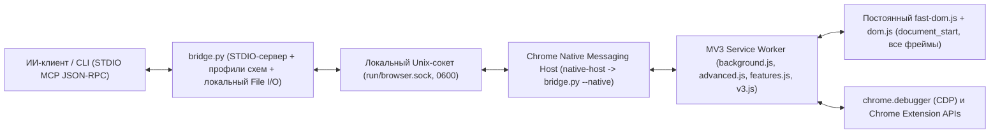

<div align="center">

# Max Browser MCP

[English](README.md) | **Русский**

[](https://github.com/DanielLetto2020/max-browser-mcp/releases)
[](https://danielletto2020.github.io/max-browser-mcp/)
[](LICENSE)
[](#полный-каталог-инструментов-83-тулзы)
[](extension/manifest.json)
[](bridge.py)

**Локальное расширение Chrome MV3 + Native Messaging хост + STDIO MCP-сервер.**  
Подключите **любого ИИ-агента и любую модель** к вашему живому браузеру Chrome: **83 инструмента**, **экономия более 50% токенов на схемах**, **ускоренная логика управления в один IPC** и **полная автономность без облака**.  
Интерактивный лендинг: **[danielletto2020.github.io/max-browser-mcp](https://danielletto2020.github.io/max-browser-mcp/)**

</div>

---

## Зачем нужен Max Browser MCP?

В отличие от headless-движков вроде Playwright или Puppeteer, которые поднимают пустой отдельный браузер, **Max Browser MCP** работает прямо в **вашем живом Chrome**:

- **Реальный браузер и авторизации**: сохраняются ваши открытые вкладки, сессии, cookies, расширения и рабочий VPN/прокси.
- **100% локально и без внешних зависимостей**: чистый Python stdlib-мост (`bridge.py`), Chrome Native Messaging, приватный Unix-сокет с правами `0600` (`run/browser.sock`) и нативный JavaScript MV3 — без Node-рантайма и npm-пакетов в продакшене.
- **Спроектировано для ИИ-агентов**: каждое решение направлено на снижение расхода токенов модели и сокращение задержек между действиями.

## Любой ИИ-агент и честная скорость работы

- **Работает с любым агентом и любой моделью**: стандартный **STDIO MCP** подключается к **Claude Code, Antigravity, Cursor, Windsurf, Cline, Zed, VS Code / Copilot, Codex CLI** и любым вашим скриптам — с моделями Claude, Gemini, GPT или локальными LLM без привязки к одному сервису.
- **От чего на самом деле зависит скорость**: итоговое время сценария складывается из скорости размышлений **самой выбранной модели** и скорости выполнения команд **внутри браузера**. Мы не можем ускорить вычисления самой нейросети, **но максимально ускорили всю логику управления браузером**: постоянный `fast-dom.js`, выполнение цепочек в один запрос (`batch`), удержание отладчика без переподключений и сжатые дифф-снимки (`afterSnapshot`). Браузер не тормозит агента, а сама модель получает меньше лишнего текста и отвечает быстрее и за меньшее число ходов.

## Архитектура



## Экономия токенов (на 50%–80% меньше контекста)

| Механизм | Что даёт на практике |
| :--- | :--- |
| **Профили инструментов (`--profile`)** | Профиль `core` отдаёт в `tools/list` **24 базовых инструмента** (~60% экономии токенов на схемах), `qa` — **44 инструмента**, `full` — все **83 инструмента**. При этом через `tools/call` в любом профиле остаются доступны все 83 тулзы. |
| **Компактные ответы (`compact`)** | Флаг `compact: true` на действиях или глобальный режим `compactResponses` в `browser_config` убирает лишние служебные поля из ответа. |
| **Один шаг вместо двух (`afterSnapshot`)** | Параметр `afterSnapshot: "diff" | "interactive" | "tree"` сразу возвращает обновлённое состояние страницы в ответе `click`, `fill`, `fill_form`, `select_option`, `set_checked`, `press_key`, `navigate`, `reload`, `history` и `batch`. |
| **Точечное чтение DOM и текста** | `page_snapshot` поддерживает `viewportOnly`, `skipLandmarks`, `compactLists` и короткие `ref`-ссылки (`abc-1`); `get_page_text` поддерживает фильтрацию `grep`/`around`; `diagnostics_get` — `summaryOnly`. |
| **Структурированное извлечение** | `page_markdown` очищает страницу до чистого Markdown; `extract_structured` сразу собирает готовый JSON-массив по CSS-селекторам (`@href`, `@src`, `@text`). |
| **Оптимизация скриншотов** | `preset: "fast"` (JPEG 1024px), `dedupe: true` (не присылать повторные байты, если хеш кадра не изменился), `grid: true` (координатная сетка), `savePath` (прямое сохранение на диск). |

## Архитектура скорости

- **Постоянный `fast-dom.js`**: загружается на `document_start` во все фреймы и держит постоянный RPC-канал без накладных расходов повторного `chrome.scripting.executeScript`.
- **Серверный `batch` за один IPC (`_batch_exec`)**: цепочка шагов выполняется за один запрос к расширению — с DOM-фьюзингом (`fuseDom`), условиями (`when`), опциональными шагами (`optional`), циклами (`repeatUntil`), параллельными ветками (`parallel`) и подстановкой результатов `{{$stepN.path}}`.
- **Гибкая настройка через `browser_config`**: режимы `speedMode` (`visual`, `fast`, `instant`), глобальный `compactResponses`, `defaultScreenshotPreset` и удержание `chrome.debugger` по таймеру (`idleDebuggerLeaseMs`).
- **Переиспользование CDP-сессии**: отладчик не переподключается на каждый клик, экономя сотни миллисекунд.
- **Пакетные формы и запросы**: `fill_form` заполняет всю форму одним вызовом; `page_fetch` выполняет запросы в контексте авторизованной страницы.

## Полный каталог инструментов (83 тулзы)

<details>
<summary>Развернуть список всех 83 инструментов по 8 категориям</summary>

1. **Вкладки, окна и история (15)**  
   `tabs_list`, `tabs_create`, `tabs_move`, `tabs_reorder`, `tabs_activate`, `tabs_update`, `tabs_duplicate`, `tabs_close`, `windows_list`, `wait_tab`, `groups_list`, `tabs_group`, `group_update`, `tabs_ungroup`, `bookmarks_and_history`
2. **Навигация, viewport и управление (12)**  
   `navigate`, `reload`, `history`, `wait_page`, `resize_window`, `emulate`, `browser_status`, `browser_config`, `extension_reload`, `safety_config`, `control_indicator`, `recorder_control`
3. **Инспекция, JS и извлечение данных (11)**  
   `get_page_text`, `page_markdown`, `read_dom`, `query_elements`, `find_elements`, `page_snapshot`, `extract_structured`, `frames_list`, `get_styles`, `highlight_element`, `javascript`
4. **Действия, формы и диалоги (12)**  
   `click`, `hover`, `drag`, `fill`, `fill_form`, `select_option`, `set_checked`, `press_key`, `insert_text`, `scroll`, `scroll_to_text`, `handle_dialog`
5. **Ожидания и пакетное выполнение (6)**  
   `wait_for`, `wait_change`, `wait_network`, `wait_until_js`, `wait`, `batch`
6. **Скриншоты, визуальный diff и PDF (3)**  
   `screenshot`, `visual_diff`, `print_to_pdf`
7. **Аудиты и производительность (4)**  
   `audit_layout`, `audit_responsive`, `accessibility_audit`, `performance_metrics`
8. **Сеть, API, сессии, хранилища и файлы (20)**  
   `diagnostics_start`, `diagnostics_get`, `diagnostics_stop`, `network_har_export`, `replay_request`, `page_fetch`, `route_mock`, `route_clear`, `session_state`, `storage_get`, `storage_set`, `cookies_list`, `cookies_set`, `cookies_delete`, `clipboard_read`, `clipboard_write`, `upload_files`, `download_start`, `downloads_list`, `download_wait`

</details>

## Встроенный интерфейс и страница «О расширении»

Нажмите на иконку **Max Browser** на панели Chrome, чтобы открыть **Popup-панель управления**:
- статус подключения, текущая версия и список открытых вкладок;
- быстрые переключатели **Speed Mode**, **Compact Responses**, **Safety Mode** и **Action Recorder**;
- кнопка **«О расширении»**, открывающая встроенную страницу `about.html` с интерактивным каталогом всех 83 инструментов, разбором экономии токенов и проверкой состояния моста понятным языком.

## Безопасность и приватность

- **Только локальный обмен**: взаимодействие идёт строго через Native Messaging и Unix-сокет (`run/browser.sock`) с правами `0600`. Никакой телеметрии и облачных серверов.
- **Автоматическая редакция секретов**: пароли, скрытые/платёжные поля, заголовки авторизации, токены в URL и секретные ключи в JSON маскируются в снимках, сетевых логах, HAR и записях рекордера.
- **Защита чувствительных путей**: файловые операции (`upload_files`, `session_state`, `network_har_export`, `visual_diff`, `screenshot`, `print_to_pdf`) блокируют системные файлы и директории ключей (`/etc/shadow`, `/etc/passwd`, `/.ssh/`, `/.aws/`, `/.gnupg/`, профили браузеров и т.п.).
- **Политики безопасности (`safety_config`)**: режимы `readonly`, `safe`, `full`, контроль исполнения JS и белые/чёрные списки доменов.
- **Поле `"key"` в `extension/manifest.json`**: это стандартный **публичный RSA-ключ Chrome**, необходимый только для сохранения постоянного ID распакованного расширения (`pokochlnfaddpcmnlilacfhfdhfplndi`) в конфигурации `NativeMessagingHosts`. Это **не** секрет и не приватный ключ.

## Быстрый старт

### 1. Клонирование и установка Native Messaging хоста

```sh
git clone https://github.com/DanielLetto2020/max-browser-mcp.git
cd max-browser-mcp
./install.sh
```

> Либо скачайте готовый `.zip`-архив из [последнего релиза на GitHub](https://github.com/DanielLetto2020/max-browser-mcp/releases/latest), распакуйте и выполните `./install.sh`.

### 2. Установка расширения в Chrome

1. Откройте `chrome://extensions` в Google Chrome (или Chromium/Brave).
2. Включите **Режим разработчика** (переключатель в правом верхнем углу).
3. Нажмите **Загрузить распакованное расширение** и выберите папку `extension/` внутри репозитория.

### 3. Подключение MCP-сервера в ИИ-клиенте

Полный набор (все 83 инструмента):

```json
{
  "mcpServers": {
    "max_browser": {
      "command": "/АБСОЛЮТНЫЙ/ПУТЬ/К/max-browser-mcp/bridge.py"
    }
  }
}
```

Экономный профиль `core` (24 схемы в `tools/list`, все 83 остаются доступны к вызову):

```json
{
  "mcpServers": {
    "max_browser": {
      "command": "/АБСОЛЮТНЫЙ/ПУТЬ/К/max-browser-mcp/bridge.py",
      "args": ["--profile", "core"]
    }
  }
}
```

## Ветки, версионирование и политика релизов

- **Ветки**:
  - `dev` — **строго локальная** ветка разработки (на публичный GitHub не отправляется).
  - `main` — единственная публичная защищённая ветка на GitHub (стабильные релизы).
- **Версионирование (`3.0.<количество_коммитов>`)**:
  - Начальный публичный релиз: **`3.0.0`**
  - Все последующие релизы нумеруются строго как **`3.0.<N>`** (`3.0.1`, `3.0.2`, ..., `3.0.1252`), где `<N>` — число коммитов разработки в `dev` после `v3.0.0`.
- **Правило релизов**: создание релизов, тегов `v*` и слияние в `main` выполняются **строго с явного разрешения владельца репозитория**. Подробнее — в [RELEASING.md](RELEASING.md).

## Проверка и тесты

```sh
./install.sh --no-hosts --test
./scripts/check_privacy.sh
```

Запускаются `py_compile`, валидация JSON, `node --check` для всех скриптов расширения, Python `unittest` (`test/test_bridge.py`), Node-тесты (`test/browser.test.js`, `test/dom.test.js`) и проверка отсутствия утечек ключей/личных путей.

## Лицензия

Проект распространяется по лицензии [MIT No Attribution (MIT-0)](LICENSE) — полное свободное использование, изменение и распространение без обязательного указания авторства.
